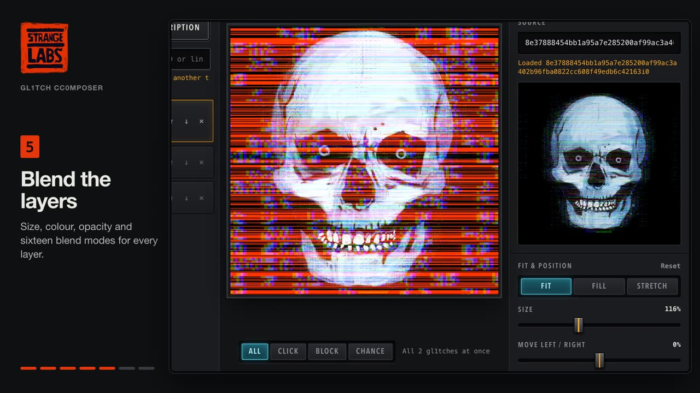

# Gl1tch CC0mposer

The Gl1tch CC0mposer is a tool for making glitch art on Bitcoin. You stack moving gl1tches with your own inscriptions, tune every layer, pick how the piece plays, and export one small HTML file. Inscribe that file and the piece runs from Bitcoin for good.

**Open it:** [ordinals.com/content/8e93bc14…2303i0](https://ordinals.com/content/8e93bc148d9f8172ecb25e3831eaaf606ef932af7b146cf1c738084507302303i0)

That link always opens the newest version, because the tool lives on one sat and every update is inscribed on that same sat.

## What you can make

* A gl1tch on its own, in your colours.
* Your art with a gl1tch over it, under it, or blended into it.
* A piece that changes: on click, on every new Bitcoin block, or a different gl1tch for each copy you inscribe.

## What it costs

Using the tool is free. The only cost is inscribing the file you export, which is usually small: a few thousand bytes.

## Who made it

Grimble built the first CC0mposer. Version 2 and the GL1TCH ENG1NE that draws the gl1tches are by Solemn. The gl1tches are CC0, so you can use them in anything.

## Watch it first

The [walkthrough video](../assets/walkthrough.mp4) shows the whole thing in 45 seconds.
